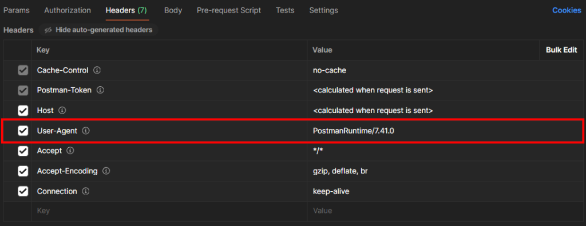
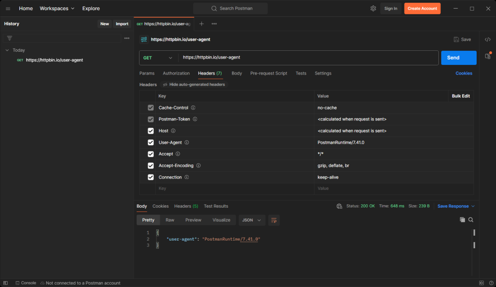
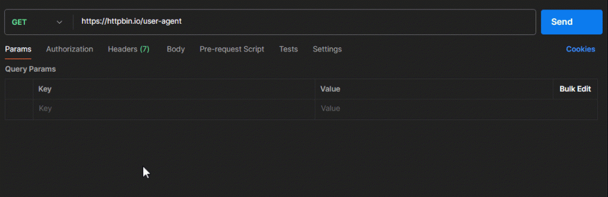
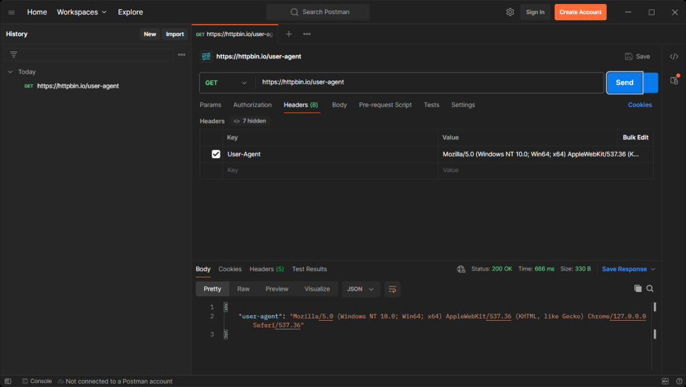
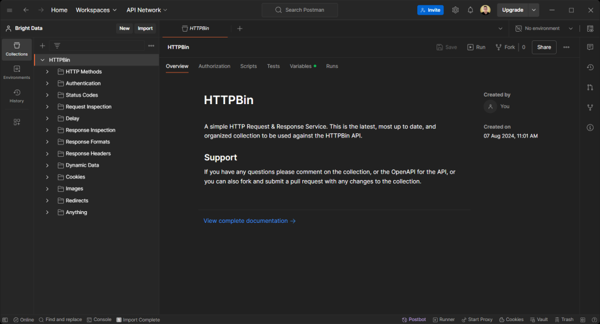
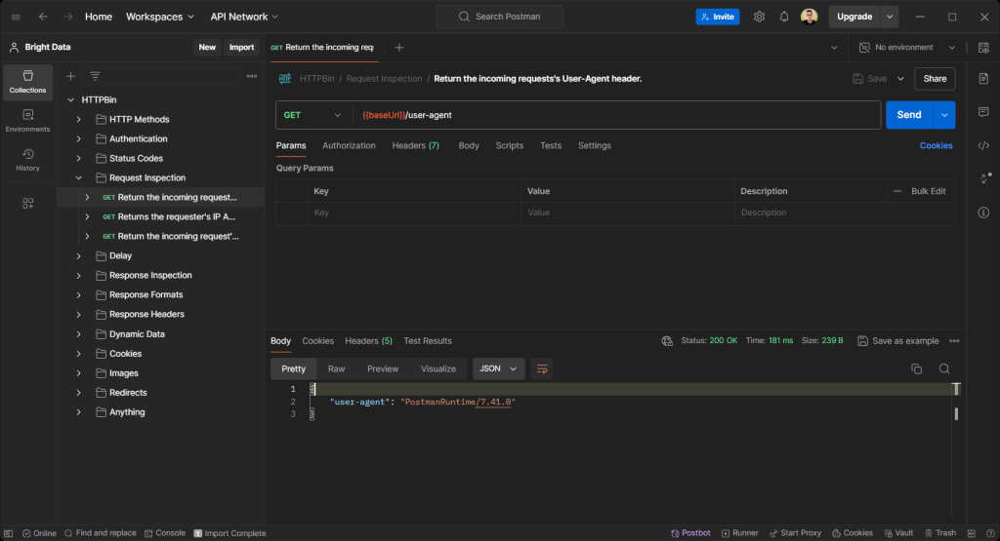
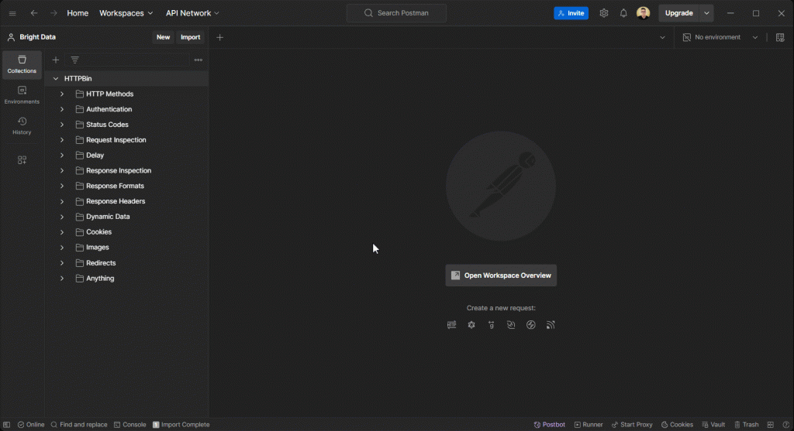
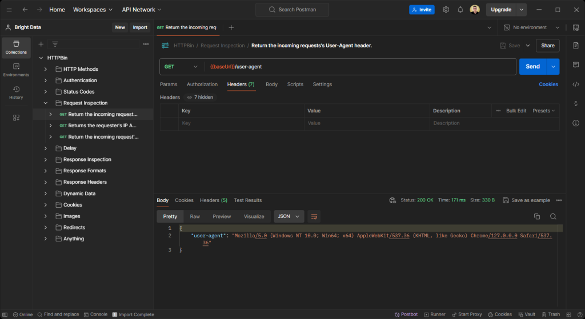
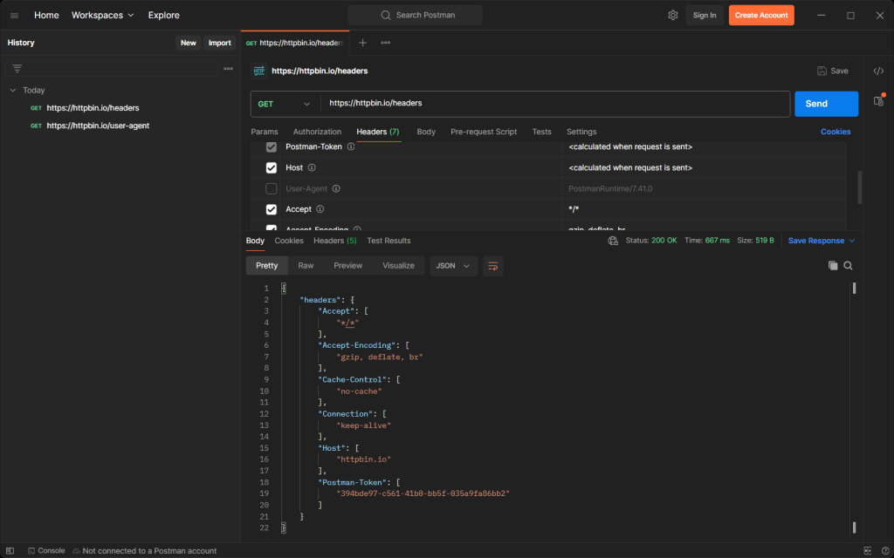
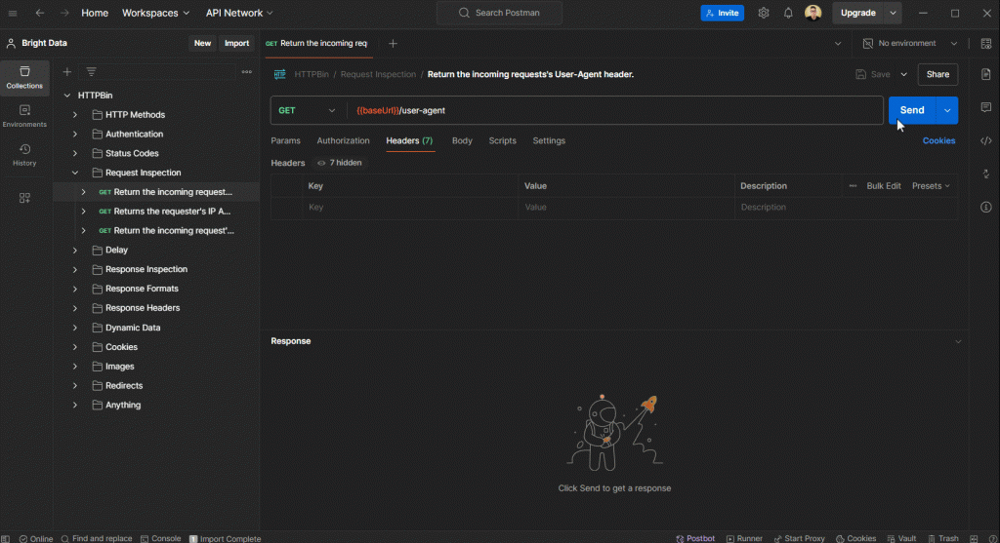

# 设置和更改 Postman User-Agent 请求头

[](https://www.bright.cn/) 

本指南介绍了如何在 Postman 中设置、更改和轮换 User-Agent 请求头，以避开反机器人检测并改进 HTTP 请求：

- [什么是 Postman 默认 User-Agent？](#什么是-postman-默认-user-agent)
- [如何更改 Postman User-Agent](#如何更改-postman-user-agent)
  - [为单个请求设置 User-Agent](#为单个请求设置-user-agent)
  - [为整个集合设置 User-Agent](#为整个集合设置-user-agent)
  - [取消设置 User-Agent](#取消设置-user-agent)
- [在 Postman 中实现 User-Agent 轮换](#在-postman-中实现-user-agent-轮换)
  - [获取 User-Agent 列表](#获取-user-agent-列表)
  - [随机选择 User-Agent](#随机选择-user-agent)
  - [定义 User-Agent 请求头](#定义-user-agent-请求头)
  - [整合所有步骤](#整合所有步骤)

## 为什么需要设置自定义 User-Agent

[`User-Agent`](https://developer.mozilla.org/en-US/docs/Web/HTTP/Headers/User-Agent) 请求头用于标识发起 HTTP 请求的客户端。它通常包含客户端设备以及发起请求所用应用程序的详细信息。网页浏览器、[HTTP 客户端](https://www.bright.cn/blog/web-data/best-python-http-clients)和其他软件会自动设置此请求头。

以下是 Chrome 请求网页时使用的 `User-Agent` 字符串示例：

```
Mozilla/5.0 (Macintosh; Intel Mac OS X 10_15_7) AppleWebKit/537.36 (KHTML, like Gecko) Chrome/127.0.0.0 Safari/537.36
```

浏览器的 `User-Agent` 请求头由几个关键部分组成：

- **`Mozilla/5.0`**：最初用于表示与 Mozilla 兼容；现在保留它是为了提供更广泛的支持。  
- **`Macintosh; Intel Mac OS X 10_15_7`**：表示操作系统（`Mac OS X 10.15.7`）和平台（Intel Mac）。  
- **`AppleWebKit/537.36`**：指定 Chrome 使用的渲染引擎。  
- **`(KHTML, like Gecko)`**：确保与 KHTML 和 Gecko 布局引擎兼容。  
- **`Chrome/127.0.0.0`**：表示浏览器名称和版本。  
- **`Safari/537.36`**：表示与 Safari 兼容。  

服务器使用 `User-Agent` 请求头来判断请求是来自浏览器还是其他来源。  

网页爬虫机器人的一个常见错误是使用默认或非浏览器的 `User-Agent` 字符串，这很容易被反机器人防护系统检测并拦截。

## 什么是 Postman 默认 User-Agent？

[Postman](https://www.postman.com/) 是一款广泛使用的桌面 HTTP 客户端。与大多数 HTTP 客户端一样，它会在每个请求中自动设置默认的 `User-Agent` 请求头。

你可以通过检查 Postman 自动生成的请求头来观察这一行为。



如你所见，Postman 默认 User-Agent 采用以下格式：

```
PostmanRuntime/x.y.z
```

`PostmanRuntime/x.y.z` 字符串表示该请求由 Postman 发起，其中 `x.y.z` 表示版本号。

要进行确认，请向 [`httpbin.io/user-agent`](https://httpbin.io/user-agent) 发送 GET 请求。此端点会返回传入请求的 `User-Agent` 请求头，让你能够验证任何 HTTP 客户端使用的 User-Agent。



请注意，API 返回的 User-Agent 与 Postman 默认设置的 User-Agent 一致。具体来说，Postman User-Agent 为：

```
PostmanRuntime/7.41.0
```

Postman 的 `User-Agent` 与浏览器请求头不同，因此请求更容易被反机器人系统拦截。这些系统会检测类似机器人的模式，包括异常的 User-Agent。更改默认的 `User-Agent` 有助于避开检测。

## 如何更改 Postman User-Agent

### 为单个请求设置 User-Agent

Postman 允许你通过手动指定 `User-Agent` 请求头，更改单个 HTTP 请求的 User-Agent。

> **注意**：
> 
> 无法直接修改 Postman 自动生成的请求头。

转到“Headers”选项卡并添加新的 `User-Agent` 请求头：



Postman 会使用你的自定义请求头替换其默认的 `User-Agent`。由于 [HTTP 请求头不区分大小写](https://developer.mozilla.org/en-US/docs/Web/HTTP/Headers)，你可以使用 `User-Agent`、`user-agent` 或任何其他大小写形式。

向 `httpbin.io/user-agent` 发送 GET 请求以验证更改。



### 为整个集合设置 User-Agent

[Postman 集合](https://www.postman.com/collection/)是一组共享配置的 API 请求。Postman 允许定义在集合中每个请求之前或之后运行的[自定义脚本](https://learning.postman.com/docs/tests-and-scripts/write-scripts/intro-to-scripts/)。

要将自定义 `User-Agent` 应用于所有请求，请登录你的 Postman 账户或[创建账户](https://www.postman.com/postman-account/)。  

假设你有一个名为“HTTPBin”的集合，其中按结构整理了 HTTPBin 端点：



执行针对 `/user-agent` 端点的请求，你将得到 Postman 默认 User-Agent：



[请求前脚本](https://learning.postman.com/docs/tests-and-scripts/write-scripts/pre-request-scripts/)是在 Postman 集合中每个请求之前运行的 JavaScript 函数。你可以用它设置自定义 `User-Agent` 请求头。

要创建请求前脚本：  
1. 打开你的集合。  
2. 转到 **Scripts** 选项卡。  
3. 选择 **Pre-request** 选项。  



在编辑器中粘贴以下代码：

```js
pm.request.headers.add({

key: "User-Agent",

value: "<your-user-agent>"

});
```

将 `<your-user-agent>` 字符串替换为你想使用的 User-Agent 值，如下所示：

```js
pm.request.headers.add({

key: "User-Agent",

value: "Mozilla/5.0 (Windows NT 10.0; Win64; x64) AppleWebKit/537.36 (KHTML, like Gecko) Chrome/127.0.0.0 Safari/537.36"

});
```

[`pm.request.headers.add()`](https://learning.postman.com/docs/tests-and-scripts/write-scripts/postman-sandbox-api-reference/) 是 Postman API 中的一个特殊函数，用于向请求添加指定的请求头。

点击“Save”按钮以应用更改。

再次执行针对 `/user-agent` 端点的请求：



这一次，返回的 User-Agent 将是脚本中设置的值，而不是 Postman 的默认值。

### 取消设置 User-Agent

自动生成的 `User-Agent` 请求头是可选的，你可以取消勾选它。取消勾选后，Postman 将不再发送 `User-Agent` 请求头。

向 [`httpbin.io/headers`](https://httpbin.io/headers) 端点发送请求进行验证，该端点会返回传入请求的所有请求头：



请注意，该端点返回的请求头对象中不包含 `User-Agent` 键。

> **注意**：
>
> 不建议取消设置 `User-Agent` 请求头，因为几乎所有网页请求通常都会包含此请求头。

## 在 Postman 中实现 User-Agent 轮换

仅将 Postman 的 `User-Agent` 替换为浏览器字符串可能无法绕过反机器人系统，尤其是从同一 IP 重复发起请求时。

为避免被检测，请使用 _User-Agent 轮换_，为每个请求分配不同的 `User-Agent`。这样可以降低被标记为机器人的可能性。

下面了解如何在 Postman 中实现 User-Agent 轮换。

### 获取 User-Agent 列表

访问 [WhatIsMyBrowser.com](https://www.whatismybrowser.com/guides/the-latest-user-agent/) 等网站，并生成一个有效的 User-Agent 列表：

```js
const userAgents = [

"Mozilla/5.0 (Windows NT 10.0; Win64; x64) AppleWebKit/537.36 (KHTML, like Gecko) Chrome/127.0.0.0 Safari/537.36 Edg/127.0.2651.86",

"Mozilla/5.0 (Macintosh; Intel Mac OS X 10_15_7) AppleWebKit/537.36 (KHTML, like Gecko) Chrome/127.0.0.0 Safari/537.36 Edg/127.0.2651.86",

"Mozilla/5.0 (Linux; Android 10; HD1913) AppleWebKit/537.36 (KHTML, like Gecko) Chrome/127.0.6533.103 Mobile Safari/537.36 EdgA/127.0.2651.82",

"Mozilla/5.0 (Windows NT 10.0; Win64; x64) AppleWebKit/537.36 (KHTML, like Gecko) Chrome/127.0.0.0 Safari/537.36",

"Mozilla/5.0 (Macintosh; Intel Mac OS X 10_15_7) AppleWebKit/537.36 (KHTML, like Gecko) Chrome/127.0.0.0 Safari/537.36",

"Mozilla/5.0 (iPhone; CPU iPhone OS 17_6 like Mac OS X) AppleWebKit/605.1.15 (KHTML, like Gecko) CriOS/127.0.6533.107 Mobile/15E148 Safari/604.1",

"Mozilla/5.0 (Windows NT 10.0; Win64; x64; rv:129.0) Gecko/20100101 Firefox/129.0",

"Mozilla/5.0 (Macintosh; Intel Mac OS X 14.6; rv:129.0) Gecko/20100101 Firefox/129.0",

// other user agents...

];
```

> **提示**：
> 
> 此数组包含的真实 User-Agent 越多，轮换选择的空间就越大。

### 随机选择 User-Agent

使用 JavaScript [`Math`](https://developer.mozilla.org/en-US/docs/Web/JavaScript/Reference/Global_Objects/Math) API 从列表中随机选择一个 User-Agent：

```js
const userAgent = serAgents[Math.floor(Math.random() * userAgents.length)];
```

下面是这行代码的执行过程：

1.  [`Math.random()`](https://developer.mozilla.org/en-US/docs/Web/JavaScript/Reference/Global_Objects/Math/random) 会生成一个介于 0 和 1 之间的随机数。
2.  然后，将生成的数字乘以 `userAgents` 数组的长度。
3.  [`Math.floor()`](https://developer.mozilla.org/en-US/docs/Web/JavaScript/Reference/Global_Objects/Math/floor) 将结果向下取整为小于或等于原数字的最大整数。得到的数字对应一个从 0 到 `userAgents.length - 1` 的索引。
4.  使用该索引从 User-Agent 数组中随机访问一个元素。
5.  将随机选择的 User-Agent 赋值给一个变量。

### 定义 User-Agent 请求头

使用 `pm.request.headers.add()`，以随机的 `userAgent` 值定义 `User-Agent` 请求头：

```js
pm.request.headers.add({

key: "User-Agent",

value: userAgent

});
```

该集合的 HTTP 请求现在将包含轮换的 `User-Agent` 请求头。

### 整合所有步骤

以下是用于轮换 User-Agent 的最终 Postman 请求前脚本：

```js
// a list of valid user agents

const userAgents = [

"Mozilla/5.0 (Windows NT 10.0; Win64; x64) AppleWebKit/537.36 (KHTML, like Gecko) Chrome/127.0.0.0 Safari/537.36 Edg/127.0.2651.86",

"Mozilla/5.0 (Macintosh; Intel Mac OS X 10_15_7) AppleWebKit/537.36 (KHTML, like Gecko) Chrome/127.0.0.0 Safari/537.36 Edg/127.0.2651.86",

"Mozilla/5.0 (Linux; Android 10; HD1913) AppleWebKit/537.36 (KHTML, like Gecko) Chrome/127.0.6533.103 Mobile Safari/537.36 EdgA/127.0.2651.82",

"Mozilla/5.0 (Windows NT 10.0; Win64; x64) AppleWebKit/537.36 (KHTML, like Gecko) Chrome/127.0.0.0 Safari/537.36",

"Mozilla/5.0 (Macintosh; Intel Mac OS X 10_15_7) AppleWebKit/537.36 (KHTML, like Gecko) Chrome/127.0.0.0 Safari/537.36",

"Mozilla/5.0 (iPhone; CPU iPhone OS 17_6 like Mac OS X) AppleWebKit/605.1.15 (KHTML, like Gecko) CriOS/127.0.6533.107 Mobile/15E148 Safari/604.1",

"Mozilla/5.0 (Windows NT 10.0; Win64; x64; rv:129.0) Gecko/20100101 Firefox/129.0",

"Mozilla/5.0 (Macintosh; Intel Mac OS X 14.6; rv:129.0) Gecko/20100101 Firefox/129.0",

// other user agents...

];

// randomly extract a user agent from the list

const userAgent = userAgents[Math.floor(Math.random() * userAgents.length)];

// set the random user agent header

pm.request.headers.add({

key: "User-Agent",

value: userAgent

});
```

将该脚本添加到你的集合中，并通过向 `httpbin.io/user-agent` 发送请求进行测试。多次运行请求，观察 User-Agent 的实际轮换效果。



返回的 User-Agent 会不断变化。

## 总结

覆盖 `User-Agent` 请求头并实现 User-Agent 轮换，有助于避开基础的反机器人机制。不过，更高级的系统仍然可以拦截你的请求。为防止 IP 被封禁，你可以[在 Postman 中使用代理](https://www.bright.cn/integration/postman)。

立即注册，开始免费试用。
